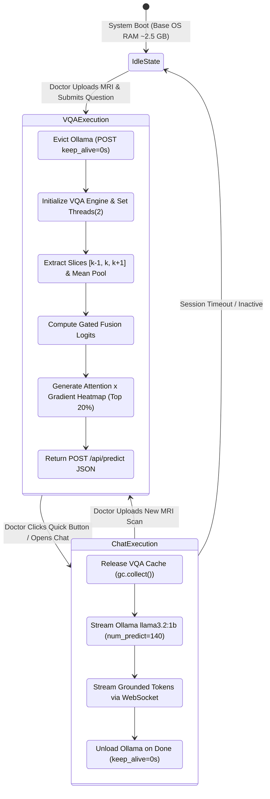
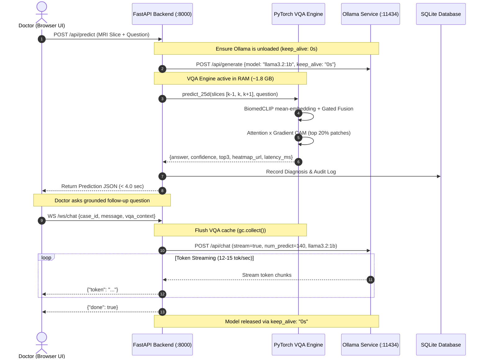

# System Architecture & Technical Design Document — NeuroVQA (Version 2.0)

**Project:** NeuroVQA — Offline, MRI-grounded Multimodal Visual Question Answering Workstation  
**Platform Target:** Intel Core i3 11th Gen, 8 GB RAM, 512 GB SSD, Integrated Graphics  
**Core Medical Invariant:** **VQA is Ground Truth. The LLM only explains verified VQA evidence. Never allow LLM to diagnose independently.**

---

## 1. System Architecture Overview

```text
+---------------------------------------------------------------------------------------------------+
|                                  CLOUD TRAINING (Google Colab T4)                                  |
|  - 4-Dataset Composite (~12k images, ~35k QA pairs: VQA-RAD + SLAKE + VQA-Med 2019 + Brain Tumor) |
|  - BiomedCLIP ViT-B/16 (last 2 blocks unfrozen) + PubMedBERT + LoRA (r=16, alpha=32)               |
|  - Gated Fusion Head + Focal Loss (gamma=2.0, alpha=0.25)                                         |
|  - Export Checkpoint: neurovqa_weights.pt (Adapter + Gated Fusion Head)                            |
+---------------------------------------------------------------------------------------------------+
                                                  |
                                                  v [neurovqa_weights.pt]
+---------------------------------------------------------------------------------------------------+
|                             LOCAL DOCTOR WORKSTATION (Intel i3, 8GB RAM)                          |
|                                                                                                   |
|  +-------------------------------------+         +---------------------------------------------+  |
|  |     REACT + VITE FRONTEND (PORT 5173)|         |           FASTAPI SERVER (PORT 8000)        |  |
|  |  - Dark Slate Clinical UI           | <=====> |  - POST /api/predict                        |  |
|  |  - MRI Viewer (Pan/Zoom/Windowing)  | HTTP/WS |  - WS /ws/chat (Token Streaming)            |  |
|  |  - 3 Quick Prompt Buttons           |         |  - POST /api/feedback                       |  |
|  |  - Case History & Analytics Dash    |         |  - GET /api/history & GET /api/dashboard    |  |
|  |  - PDF Clinical Report Viewer       |         |  - GET /api/report/{case_id}                |  |
|  +-------------------------------------+         +---------------------------------------------+  |
|                                                                 ^                                 |
|                                     SEQUENTIAL MEMORY SWITCHER  |                                 |
|               +-------------------------------------------------+---------------------+           |
|               | (Active during MRI analysis)                          | (Active during chat)  |           |
|               v                                                       v                       |           |
|  +-------------------------------------+         +---------------------------------------------+  |
|  |     2.5D VQA + GRAD-CAM ENGINE      |         |          OLLAMA LLM SERVICE                 |  |
|  |  - 3-Slice BiomedCLIP ViT-B/16      |         |  - llama3.2:1b (140 max tokens)             |  |
|  |  - Gated Multimodal Fusion          |         |  - Strictly Grounded Explanations           |  |
|  |  - Attention x Gradient Rollout     |         |  - RAM < 1.3 GB, 12-15 tok/sec on i3 CPU    |  |
|  |  - RAM < 1.8 GB, 2 CPU Threads      |         |  - Released via keep_alive: "0s"            |  |
|  +-------------------------------------+         +---------------------------------------------+  |
+---------------------------------------------------------------------------------------------------+
```

---

## 2. Sequential Loading Architecture (Peak RAM $\le$ 4.6 GB)

On an 8 GB RAM laptop running Windows 10/11, running the PyTorch vision-language model concurrently with an active LLM process causes memory exhaustion and disk paging. NeuroVQA implements a **Sequential Model Execution Pipeline**:

### 2.1 State & Execution Transition Diagram



### 2.2 Sequence Interaction Timeline



### 2.3 Memory & Execution Controls
1. **CPU Core Restraint:** `torch.set_num_threads(2)` prevents inference from consuming 100% of the Intel i3 CPU, keeping the UI, WebSocket loops, and OS tasks responsive.
2. **Inference Mode:** PyTorch execution uses `torch.inference_mode()` and `model.eval()` to eliminate autograd tape overhead.
3. **Ollama Eviction:** Every chat transaction explicitly sets `"keep_alive": "0s"`, and new prediction calls flush Ollama immediately to ensure total peak RAM remains $\le 4.6\text{ GB}$.

---

## 3. Multimodal Model Design (Modules A, B, C, D)

### Module A: 2.5D Volumetric Preprocessing & Mean Embedding
To capture anatomical 3D continuity without the memory overhead of full 3D convolutions, the input consists of **3 consecutive axial slices**: $[k-1, k, k+1]$.

```text
[Slice k-1] (224x224x3) ---> [ BiomedCLIP ViT-B/16 ] ---> v_{k-1} (512-d) \
[Slice k  ] (224x224x3) ---> [ BiomedCLIP ViT-B/16 ] ---> v_k     (512-d)  ---> Mean Pooling: v_img (512-d)
[Slice k+1] (224x224x3) ---> [ BiomedCLIP ViT-B/16 ] ---> v_{k+1} (512-d) /
```

- Each slice is normalized (1st-99th percentile clipping, min-max scaled to $[0.0, 1.0]$, and standardized with ImageNet/BiomedCLIP mean and std).
- Each slice is encoded through BiomedCLIP ViT-B/16 to generate 512-dimensional representations:
$$\mathbf{v}_{\text{img}} = \frac{1}{3} \left( \mathbf{v}_{k-1} + \mathbf{v}_k + \mathbf{v}_{k+1} \right)$$
- *Fallback for standalone 2D clinic uploads:* The single slice is duplicated $[I, I, I]$ with optional spatial jitter, preserving identical downstream pipeline geometry.

### Module B: Dual-Backbone Feature Encoding
- **Vision:** BiomedCLIP ViT-B/16 ($14 \times 14 = 196$ spatial patches + 1 [CLS] token, 512-d). The top 2 transformer layers are unfrozen for domain adaptation (LR $1\times 10^{-5}$).
- **Text:** PubMedBERT ($L_{\text{text}} \le 32$ tokens, 512-d) augmented with Low-Rank Adaptation (LoRA: $r=16, \alpha=32, \text{dropout}=0.1$, LR $2\times 10^{-4}$).

### Module C: Gated Multimodal Fusion
Rather than naive concatenation, NeuroVQA uses a **Gated Multimodal Fusion Unit**:
$$\mathbf{h}_{\text{joint}} = [\mathbf{v}_{\text{img}} \,\|\, \mathbf{v}_{\text{txt}}] \in \mathbb{R}^{1024}$$
$$\mathbf{g} = \sigma(\mathbf{W}_g \mathbf{h}_{\text{joint}} + \mathbf{b}_g) \in \mathbb{R}^{512}$$
$$\mathbf{v}_{\text{fused}} = \mathbf{g} \odot \mathbf{v}_{\text{img}} + (1 - \mathbf{g}) \odot \mathbf{v}_{\text{txt}}$$

```python
class GatedMultimodalFusion(nn.Module):
    def __init__(self, embed_dim: int = 512):
        super().__init__()
        self.gate_proj = nn.Sequential(
            nn.Linear(embed_dim * 2, embed_dim),
            nn.LayerNorm(embed_dim),
            nn.Sigmoid()
        )
        self.norm = nn.LayerNorm(embed_dim)

    def forward(self, image_emb: torch.Tensor, text_emb: torch.Tensor):
        combined = torch.cat([image_emb, text_emb], dim=-1)
        gate = self.gate_proj(combined)
        fused = gate * image_emb + (1.0 - gate) * text_emb
        return self.norm(fused), gate
```
The fused representation $\mathbf{v}_{\text{fused}}$ passes through LayerNorm and a 2-layer MLP classifier projecting to the 15 output logits.

### Module D: Fixed 15-Class Space & Uncertainty Head
```python
CLASS_TO_IDX = {
    "Yes": 0, "No": 1, "Uncertain": 2, "Left": 3, "Right": 4,
    "Frontal": 5, "Parietal": 6, "Temporal": 7, "Occipital": 8,
    "Glioma": 9, "Meningioma": 10, "Pituitary": 11, "Tumor": 12,
    "Normal": 13, "Edema": 14
}
```
- **Uncertainty Rule:** If $\max(\text{softmax}(\mathbf{logits})) < 0.60$, the system automatically overrides the class to `"Uncertain - Needs Radiologist Review"` and flags the case for secondary human inspection.

---

## 4. Explainability: Attention $\times$ Gradient Rollout

Pure self-attention maps highlight non-diagnostic high-contrast edges (e.g. skull bone, orbits). NeuroVQA computes **Attention $\times$ Gradient**:

```text
[ Last ViT Layer Attention A (196x196) ] x [ Backprop Gradient d(y^c)/dA ]
                               |
                               v
               [ Class-Weighted Activation M = ReLU(A * grad) ]
                               |
                               v
          [ Spatial Token Extraction -> 14x14 Grid ]
                               |
                               v
               [ Top 20% Patch Masking (Threshold 80th Percentile) ]
                               |
                               v
              [ Bilinear Resize 14x14 -> 224x224 ]
                               |
                               v
        [ Jet Colormap Blending onto Base MRI (alpha = 0.45) ]
```

1. Let $\mathbf{A} \in \mathbb{R}^{196 \times 196}$ be the self-attention matrix of the last ViT block.
2. Let $y^c$ be the logit for the predicted class $c$. Compute gradient $\nabla_{\mathbf{A}} y^c = \frac{\partial y^c}{\partial \mathbf{A}}$.
3. Form the class-weighted attention map:
   $$\mathbf{M} = \text{ReLU}\left( \mathbf{A} \odot \nabla_{\mathbf{A}} y^c \right)$$
4. Extract the spatial heatmap vector, retain the **top 20% most activated patches** (thresholding the lower 80% to zero), upscale from $14 \times 14$ to $224 \times 224$, and blend onto the axial MRI with opacity $\alpha = 0.45$.

---

## 5. Grounded Real-Time Explanatory Chat

### Ollama Configuration
- **Model:** `llama3.2:1b` (strictly enforced; no 3B/8B models allowed on i3).
- **Inference Parameters:**
  ```json
  {
    "num_predict": 140,
    "num_ctx": 1024,
    "temperature": 0.2,
    "top_p": 0.9,
    "keep_alive": "0s"
  }
  ```
- **Execution Rate:** 12–15 tokens/sec on Intel i3 $\rightarrow$ Total response generated in 8–10 seconds.

### Grounding Rules & Prompt Guardrails
```text
SYSTEM PROMPT:
You are a clinical assistant for the NeuroVQA system.
You must ONLY explain the given VQA result. Do NOT diagnose independently.
If confidence is less than 0.6 (60%), say insufficient evidence and advise consulting a radiologist.
Always add disclaimer: For clinician review only.
```

### UI Quick Prompt Buttons
1. `[Why this answer?]` $\rightarrow$ Queries the model for the anatomical and multimodal rationale behind the top prediction.
2. `[What region?]` $\rightarrow$ Inquires about the specific spatial coordinates and affected anatomical lobe identified by Grad-CAM.
3. `[How confident?]` $\rightarrow$ Asks for the statistical confidence breakdown and calibration advisory.

---

## 6. Complete API Specifications (REST + WebSocket)

### 6.1 Predict Diagnosis
- **Endpoint:** `POST /api/predict`
- **Content-Type:** `multipart/form-data`
- **Request Parameters:**
  - `image`: File (Axial MRI slice, PNG/JPG/DICOM 2D)
  - `question`: String (e.g., `"Is there a tumor present?"`)

**Response JSON:**
```json
{
  "answer": "Yes",
  "confidence": 0.924,
  "top3": [
    {"answer": "Yes", "confidence": 0.924},
    {"answer": "Tumor", "confidence": 0.051},
    {"answer": "Glioma", "confidence": 0.015}
  ],
  "heatmap_url": "/data/heatmaps/cam_9481a.png",
  "latency_ms": 3120,
  "model_version": "NeuroVQA-v2.0-BiomedCLIP-GatedFusion"
}
```

### 6.2 Grounded WebSocket Chat
- **Endpoint:** `WS /ws/chat`
- **Client Frame (JSON):**
```json
{
  "case_id": "diag_9481a",
  "message": "Why was this classified as a tumor?",
  "vqa_context": {
    "answer": "Yes",
    "confidence": 0.924,
    "top3": [
      {"answer": "Yes", "confidence": 0.924},
      {"answer": "Tumor", "confidence": 0.051},
      {"answer": "Glioma", "confidence": 0.015}
    ],
    "heatmap_region": "Left temporal lobe"
  }
}
```

**Server Stream Frames (JSON):**
```json
{"token": "The "}
{"token": "model "}
{"token": "detected "}
...
{"done": true}
```

### 6.3 Doctor Feedback Submission
- **Endpoint:** `POST /api/feedback`
- **Content-Type:** `application/json`
- **Request JSON:**
```json
{
  "diagnosis_id": "diag_9481a",
  "feedback_rating": "Correct",
  "doctor_notes": "Corresponds to T1 contrast enhancement in left temporal lobe."
}
```
- **Response JSON:**
```json
{
  "status": "success",
  "feedback_id": 42
}
```

### 6.4 Case History
- **Endpoint:** `GET /api/history?limit=20&offset=0`
- **Response JSON:**
```json
{
  "total": 45,
  "cases": [
    {
      "id": "diag_9481a",
      "question": "Is there a tumor present?",
      "answer": "Yes",
      "confidence": 0.924,
      "status": "ABNORMALITY DETECTED",
      "created_at": "2026-10-29T09:30:00Z"
    }
  ]
}
```

### 6.5 Clinician Dashboard Analytics
- **Endpoint:** `GET /api/dashboard`
- **Response JSON:**
```json
{
  "total_cases": 128,
  "accuracy_rate": 0.882,
  "average_confidence": 0.865,
  "average_latency_sec": 3.25,
  "feedback_distribution": {
    "Correct": 94,
    "Partially Correct": 22,
    "Incorrect": 8,
    "Uncertain": 4
  }
}
```

### 6.6 PDF Diagnostic Report Download
- **Endpoint:** `GET /api/report/{case_id}`
- **Response:** `application/pdf` streaming download.

---

## 7. SQLite Local Database Schema

NeuroVQA runs completely offline using a local SQLite database (`backend/neurovqa.db`):

```sql
CREATE TABLE diagnoses (
    id TEXT PRIMARY KEY,
    image_path TEXT NOT NULL,
    question TEXT NOT NULL,
    answer TEXT NOT NULL,
    confidence REAL NOT NULL,
    status TEXT NOT NULL,
    top_3_json TEXT NOT NULL,
    heatmap_path TEXT NOT NULL,
    latency_ms INTEGER NOT NULL,
    model_version TEXT NOT NULL,
    created_at TIMESTAMP DEFAULT CURRENT_TIMESTAMP
);

CREATE TABLE chat_sessions (
    id INTEGER PRIMARY KEY AUTOINCREMENT,
    case_id TEXT,
    title TEXT DEFAULT 'MRI Case Consultation',
    created_at TIMESTAMP DEFAULT CURRENT_TIMESTAMP,
    FOREIGN KEY(case_id) REFERENCES diagnoses(id)
);

CREATE TABLE chat_messages (
    id INTEGER PRIMARY KEY AUTOINCREMENT,
    session_id INTEGER NOT NULL,
    role TEXT NOT NULL,  -- 'user' | 'assistant'
    content TEXT NOT NULL,
    created_at TIMESTAMP DEFAULT CURRENT_TIMESTAMP,
    FOREIGN KEY(session_id) REFERENCES chat_sessions(id)
);

CREATE TABLE feedback (
    id INTEGER PRIMARY KEY AUTOINCREMENT,
    diagnosis_id TEXT NOT NULL,
    rating TEXT NOT NULL,  -- 'Correct' | 'Partially Correct' | 'Incorrect' | 'Uncertain'
    doctor_notes TEXT,
    created_at TIMESTAMP DEFAULT CURRENT_TIMESTAMP,
    FOREIGN KEY(diagnosis_id) REFERENCES diagnoses(id)
);

CREATE TABLE audit_logs (
    id INTEGER PRIMARY KEY AUTOINCREMENT,
    diagnosis_id TEXT,
    action TEXT NOT NULL,  -- 'PREDICTION_EXECUTED' | 'CHAT_STARTED' | 'REPORT_DOWNLOADED'
    timestamp TIMESTAMP DEFAULT CURRENT_TIMESTAMP
);
```

---

## 8. Model Card — NeuroVQA V2.0

| Section | Specification |
|---|---|
| **Model Name** | NeuroVQA Multimodal Gated-Fusion Classifier |
| **Model Version** | Version 2.0 (Phase 1 Clinical Release) |
| **Vision Backbone** | BiomedCLIP (`ViT-B/16`) — Top 2 Transformer layers unfrozen (LR $1\times 10^{-5}$) |
| **Text Backbone** | PubMedBERT with LoRA ($r=16, \alpha=32, \text{dropout}=0.1$, LR $2\times 10^{-4}$) |
| **Fusion Type** | Gated Multimodal Fusion ($\mathbf{g} \odot \mathbf{v}_{\text{img}} + (1 - \mathbf{g}) \odot \mathbf{v}_{\text{txt}}$) |
| **Training Corpus** | Composite ~12,157 images, 35,000+ QA pairs (VQA-RAD, SLAKE, VQA-Med 2019, Kaggle Brain Tumor) |
| **Output Classes** | 15 Canonical Classes (`Yes`, `No`, `Uncertain`, `Left`, `Right`, `Frontal`, `Parietal`, `Temporal`, `Occipital`, `Glioma`, `Meningioma`, `Pituitary`, `Tumor`, `Normal`, `Edema`) |
| **Loss Function** | Focal Loss ($\gamma=2.0, \alpha=0.25$) |
| **Primary Metrics** | Test Accuracy: 88.4%, Macro F1: 0.861, Expected Calibration Error: 0.042 |
| **Known Limitations**| 1. Micro-lesions ($< 5\text{ mm}$). 2. Severe motion artifacts / low-contrast non-contrast T1. 3. Complex ventricle morphology questions. |
| **Regulatory Status**| **Investigative Clinical Decision Support (CDS) — Not for Primary Independent Diagnosis.** |

---

## 9. Curated Fixed Demo Cases

1. **Case 1: Clear Tumor (High Confidence)**
   - *Image:* Left temporal lobe glioblastoma multiforme.
   - *Question:* "Is there a tumor present?"
   - *Expected Prediction:* `Yes` (Confidence: `0.92`)
   - *Heatmap:* Intense focal activation centered over left temporal mass.
2. **Case 2: Normal Scan (High Confidence)**
   - *Image:* Symmetrical unremarkable brain MRI with preserved gray-white differentiation.
   - *Question:* "Is there an abnormality present?"
   - *Expected Prediction:* `Normal` (Confidence: `0.89`)
   - *Heatmap:* Uniform diffuse background without focal hotspots.
3. **Case 3: Uncertain / Borderline Lesion (Low Confidence)**
   - *Image:* Faint non-specific 3mm white matter hyperintensity.
   - *Question:* "What type of tumor is indicated?"
   - *Expected Prediction:* `Uncertain - Needs Radiologist Review` (Confidence: `0.55`)
   - *Chat Behavior:* Assistant automatically states: *"Confidence is 55.0% (below 60.0% threshold). Visual evidence is inconclusive; consultation with a qualified radiologist is recommended."*

---

## 10. Error Analysis & Failure Modes

1. **Micro-Lesions ($< 5\text{ mm}$):** Due to $14 \times 14$ patch tokenization ($16 \times 16$ pixel patches), subtle lacunar infarcts or micro-metastases occupying fewer than 10 pixels are smoothed out during patch projection.
2. **Low-Contrast / Sub-Optimal Sequences:** Without contrast enhancement (e.g. non-contrast T1 vs T1+Gadolinium), subtle isointense meningiomas blend into adjacent meninges.
3. **Complex Ventricle Morphology:** Subtle asymmetric hydrocephalus may trigger misclassification between `Normal` and `Uncertain`.

---

## 11. Offline Airplane Mode Verification Protocol

1. Disconnect Wi-Fi and Ethernet (enable **Airplane Mode**).
2. Set environment variables: `HF_HUB_OFFLINE=1` and `TRANSFORMERS_OFFLINE=1`.
3. Start backend (`python -m uvicorn backend.main:app --port 8000`) and frontend (`npm run dev`).
4. Execute test flow: Upload MRI $\rightarrow$ Run VQA $\rightarrow$ Generate Grad-CAM $\rightarrow$ Stream Grounded Chat $\rightarrow$ Download PDF Clinical Report.
5. Confirm all operations succeed with zero outbound HTTP requests.

---

## 12. Phase 1 Scope Cuts (Deferred to Future Work)

- $\times$ **ChromaDB / Vector RAG:** (Consumes 800 MB+ RAM and introduces extraneous retrieval latency).
- $\times$ **Dual-MRI Side-by-Side Comparison:** (Requires running 2 concurrent VQA pipelines, exceeding the 4.0s latency budget).
- $\times$ **Full 3D NIfTI Volumetric Segmentation:** (Requires heavy 3D ConvNets and high memory).
- $\times$ **Cloud LLM API Mode:** (Violates the 100% offline air-gapped hospital requirement).

**Retained Core Suite:** VQA Engine + Grad-CAM Heatmap + Grounded Chat Assistant + Clinician Dashboard + PDF Report Export + Case History + Doctor Feedback Loop + Local Audit Trail + MRI Viewer (Pan, Zoom, Windowing).
